# TP4DPBO2526C2
# PeopleData – Rumah Sakit Psikologi

Saya Moch Fadillah Pratama dengan NIM 2506968 mengerjakan Tugas Praktikum 3 dalam mata kuliah Desain Pemrograman Berorientasi Objek untuk keberkahan-Nya maka saya tidak akan melakukan kecurangan seperti yang telah dispesifikasikan. Aamiin.

Aplikasi desktop berbasis **Java Swing** untuk mengelola data pasien dan tenaga di sebuah Rumah Sakit Psikologi. Proyek ini dikerjakan sebagai **Tugas Praktikum 4 – Introduction to Java Swing GUI** pada mata kuliah **Desain dan Pemrograman Berorientasi Objek (DPBO)**.

Aplikasi mendukung operasi **CRUD** (Create, Read, Update, Delete) dengan penyimpanan sementara di memori (`ArrayList`), dilengkapi **konfirmasi sebelum hapus** dan **validasi input**.

---

## Daftar Isi

- [Struktur Folder](#struktur-folder)
- [Desain Program](#desain-program)
- [Fungsi Program](#fungsi-program)
- [Penjelasan Class](#penjelasan-class)
- [Alur Program](#alur-program)
- [Validasi & Error Handling](#validasi--error-handling)
- [Cara Menjalankan](#cara-menjalankan)
- [Dokumentasi Program Berjalan](#dokumentasi-program-berjalan)
- [Catatan](#catatan)

---

## Struktur Folder

```
TP4DPBO2526C.../               <- repository GitHub (public)
├── PeopleData/                <- folder project
│   ├── Person.java
│   ├── PeopleMenu.java
│   └── PeopleMenu.form
├── Dokumentasi/               <- gambar/png/video yang ditampilkan di README
│   ├── 01-read.png
│   ├── 02-create-01.png
│   ├── 02-create-02.png
│   ├── 02-create-03.png
│   ├── 03-update-01.png
│   ├── 03-update-02.png
│   ├── 03-update-03.png
│   ├── 03-update-04.png
│   ├── 04-delete-01.png
│   ├── 04-delete-02.png
│   ├── 04-delete-03.png
│   ├── 04-delete-04.png
│   └── 05-error.png
└── README.md
```

## Desain Program

### Tampilan (GUI)

Layout utama `mainPanel` memakai **GridLayoutManager** (4 baris × 1 kolom):

| Baris | Komponen | Keterangan |
|---|---|---|
| 0 | `JLabel` | Judul: "Data Pasien dan Tenaga Rumah Sakit Psikologi" |
| 1 | `formPanel` | Panel isian (5 baris × 2 kolom): ID, Nama, Tahun Lahir, Kategori, MBTI |
| 2 | `buttonPanel` | Panel tombol (1 baris × 3 kolom): Add/Update, Delete, Cancel |
| 3 | `peopleScrollPane` | Pembungkus `peopleTable` agar bisa di-scroll |

### Field name komponen (harus sama dengan variabel di Java)

| Field name | Tipe | Fungsi |
|---|---|---|
| `mainPanel` | `JPanel` | Panel root, dipasang ke `JFrame` |
| `formPanel` | `JPanel` | Penampung label dan isian |
| `idField` | `JTextField` | Isian ID |
| `namaField` | `JTextField` | Isian Nama |
| `tahunLahirField` | `JTextField` | Isian Tahun Lahir |
| `kategoriComboBox` | `JComboBox<String>` | Dropdown Kategori (Pasien, Psikolog, Psikiater, Perawat, Konselor) |
| `mbtiComboBox` | `JComboBox<String>` | Dropdown MBTI (16 tipe) |
| `buttonPanel` | `JPanel` | Penampung tombol |
| `addUpdateButton` | `JButton` | Tombol dua fungsi: Add / Update |
| `deleteButton` | `JButton` | Tombol Delete (tampil hanya saat ada baris terpilih) |
| `cancelButton` | `JButton` | Tombol Cancel |
| `peopleScrollPane` | `JScrollPane` | Pembungkus tabel |
| `peopleTable` | `JTable` | Tabel data (No, ID, Nama, Tahun Lahir, Kategori, MBTI) |

### Data awal

| ID | Nama | Tahun Lahir | Kategori | MBTI |
|---|---|---|---|---|
| P001 | Rina Amelia | 1998 | Pasien | INFJ |
| P002 | Dr. Budi Santoso | 1980 | Psikiater | INTJ |
| P003 | Sinta Maharani | 1990 | Psikolog | ENFP |
| P004 | Andi Pratama | 2001 | Pasien | ISTP |
| P005 | Lestari Dewi | 1993 | Perawat | ISFJ |
| P006 | Fajar Nugroho | 1987 | Konselor | ENFJ |

## Fungsi Program

- **Create** – menambah data baru lewat tombol *Add*.
- **Read** – menampilkan seluruh data dalam `JTable`.
- **Update** – klik baris tabel, data masuk ke form, ubah lalu tekan *Update*.
- **Delete** – hapus data terpilih dengan dialog konfirmasi (`JOptionPane.showConfirmDialog`).
- **Cancel** – mengosongkan form dan kembali ke mode *Add*.
- **Tombol dinamis** – `Add` berubah menjadi `Update` saat ada baris terpilih; `Delete` hanya muncul saat ada baris terpilih.
- **Validasi input** – input kosong, ID duplikat, format angka, dan rentang tahun lahir.
- **Atribut tambahan MBTI** – dipilih lewat `JComboBox`, bukan `JTextField`.

## Penjelasan Class

### `Person`

Class model (*blueprint*) untuk satu data orang. Tidak memiliki GUI; semua atribut `private` dan diakses lewat getter/setter (*encapsulation*).

| Atribut | Tipe | Contoh |
|---|---|---|
| `id` | `String` | `"P001"` |
| `nama` | `String` | `"Rina Amelia"` |
| `tahunLahir` | `int` | `1998` |
| `kategori` | `String` | `"Pasien"` |
| `mbti` | `String` | `"INFJ"` |

### `PeopleMenu`

| Method | Fungsi |
|---|---|
| `PeopleMenu()` | Konstruktor: menyiapkan list, mengisi tabel dan dropdown, memasang listener |
| `populateList()` | Mengisi data awal ke `personList` |
| `setTable()` | Menggambar ulang `JTable` dari `personList` (**Read**) |
| `insertData()` | Menambah data baru (**Create**) |
| `updateData()` | Mengubah data terpilih (**Update**) |
| `deleteData()` | Menghapus data terpilih setelah konfirmasi (**Delete**) |
| `clearForm()` | Reset form dan kembali ke mode *Add* |
| `readAndValidate(int)` | Membaca form, memvalidasi, mengembalikan `Person` atau `null` |
| `isIdExists(String, int)` | Mengecek ID duplikat (tidak peka huruf besar/kecil) |
| `showError(String)` | Helper dialog error |
| `main(String[])` | Titik awal program, membungkus `mainPanel` ke `JFrame` |

Atribut tambahan: `personList` (`ArrayList<Person>`) sebagai penyimpanan sementara, dan `selectedIndex` (`int`, `-1` berarti belum ada baris terpilih).

## Alur Program

### 1. Saat program dijalankan

1. `main()` membuat `JFrame` dan objek `PeopleMenu`.
2. Konstruktor membuat `personList`, memanggil `populateList()` untuk mengisi data awal, lalu `setTable()` untuk menampilkannya di tabel.
3. Dropdown Kategori dan MBTI diisi, tombol *Delete* disembunyikan, dan semua listener dipasang.
4. `mainPanel` dipasang ke `JFrame` lalu window ditampilkan di tengah layar.

### 2. Create (tambah data)

1. Pengguna mengisi form dan menekan **Add** (`selectedIndex == -1`).
2. `insertData()` memanggil `readAndValidate(-1)`.
3. Jika validasi gagal, dialog error tampil dan proses dibatalkan.
4. Jika valid, objek `Person` ditambahkan ke `personList`, tabel di-refresh (`setTable()`), form dikosongkan (`clearForm()`), dan muncul pesan sukses.

### 3. Read (tampil data)

1. `setTable()` membuat `DefaultTableModel` baru dengan kolom No, ID, Nama, Tahun Lahir, Kategori, MBTI.
2. Setiap `Person` di `personList` dimasukkan sebagai satu baris, lalu model dipasang ke `peopleTable`.
3. Method ini dipanggil setiap data berubah agar tampilan selalu sinkron.

### 4. Update (ubah data)

1. Pengguna mengklik baris tabel. `selectedIndex` diisi, data `Person` ditampilkan di form, tombol berubah menjadi **Update**, dan tombol **Delete** muncul.
2. Pengguna mengubah isian lalu menekan **Update** (`selectedIndex != -1`).
3. `updateData()` memanggil `readAndValidate(selectedIndex)`. Baris yang sedang diedit dikecualikan dari cek ID duplikat.
4. Jika valid, objek lama diperbarui lewat setter, tabel di-refresh, form di-reset ke mode *Add*, dan muncul pesan sukses.

### 5. Delete (hapus data)

1. Pengguna memilih baris lalu menekan **Delete**.
2. `deleteData()` menampilkan dialog konfirmasi berisi nama dan ID data.
3. Jika memilih **Yes**: data dihapus dari `personList`, tabel di-refresh, form di-reset, dan muncul pesan sukses.
4. Jika memilih **No** atau menutup dialog: data tetap aman.

### 6. Cancel

`clearForm()` mengosongkan semua isian, mengembalikan dropdown ke item pertama, mengubah tombol menjadi *Add*, menyembunyikan *Delete*, mereset `selectedIndex = -1`, dan menghapus sorotan baris tabel.

## Validasi & Error Handling

Semua error memakai `JOptionPane.showMessageDialog(..., JOptionPane.ERROR_MESSAGE)`.

| No | Validasi | Pesan |
|---|---|---|
| 1 | ID kosong | `ID tidak boleh kosong!` |
| 2 | Nama kosong | `Nama tidak boleh kosong!` |
| 3 | Tahun Lahir kosong | `Tahun Lahir tidak boleh kosong!` |
| 4 | ID sudah dipakai data lain | `ID "..." sudah digunakan! Gunakan ID yang berbeda.` |
| 5 | Tahun Lahir bukan angka (`try-catch NumberFormatException`) | `Tahun Lahir harus berupa angka! Contoh: 1998` |
| 6 | Tahun Lahir di luar 1900 – tahun sekarang | `Tahun Lahir harus di antara 1900 dan <tahun sekarang>!` |
| 7 | Delete tanpa memilih data | `Pilih data yang ingin dihapus terlebih dahulu!` |

## Cara Menjalankan

**Prasyarat**: JDK 8+ (disarankan 17+) dan IntelliJ IDEA.

1. Clone repository ini.
2. Buka folder `PeopleData` sebagai project di IntelliJ IDEA (atau salin ketiga file ke folder `src` project Java baru).
3. Pastikan GUI Designer aktif: **Settings → Editor → GUI Designer → Generate GUI into: Java source code**.
4. Buka `PeopleMenu.java`, klik ikon ▶ di samping `main()`, lalu pilih **Run 'PeopleMenu.main()'**.

> Jika muncul `Cannot bind: field does not exist`, pastikan nama variabel di Java sama persis dengan *field name* di `PeopleMenu.form`.

## Dokumentasi Program Berjalan

> Berkas dokumentasi disimpan di folder `Dokumentasi/`. Ganti nama berkas di bawah sesuai berkas Anda.

### 1. Tampilan awal (Read)

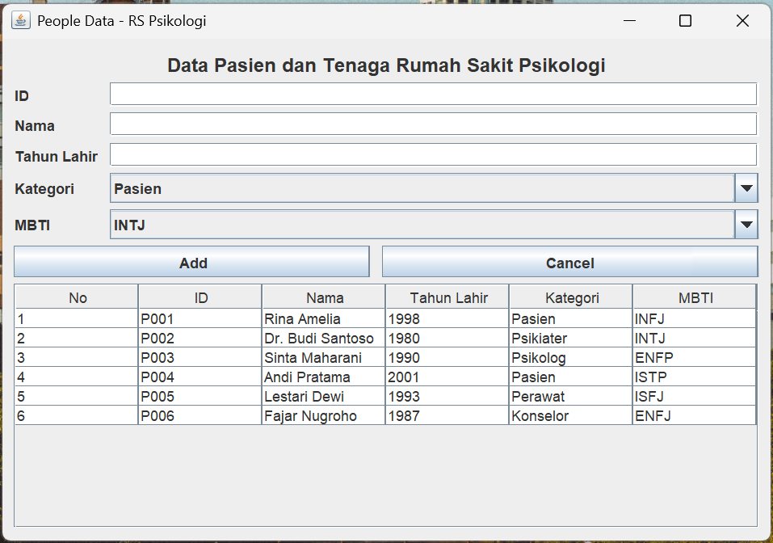

### 2. Create – menambah data

#### Mengisi data
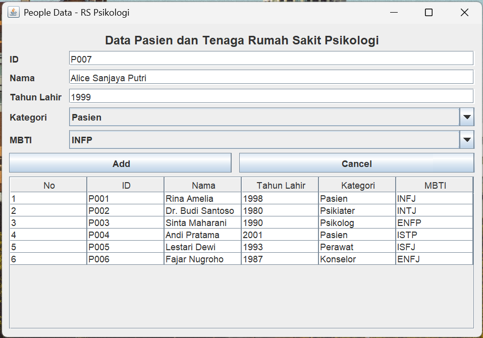

#### Data berhasil ditambahkan
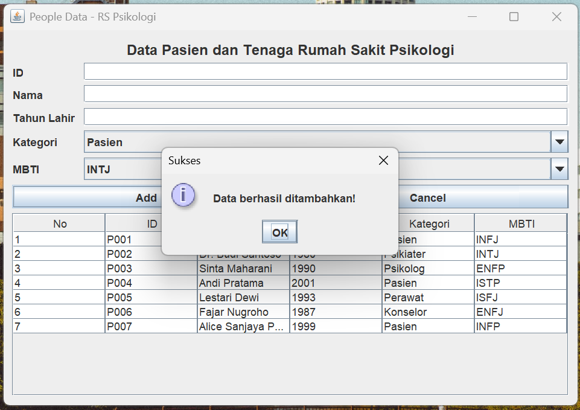

#### Menampilkan tabel setelah ditambahkan
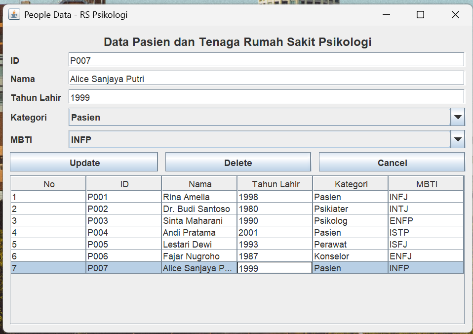

### 3. Update – mengubah data

#### Memilih data
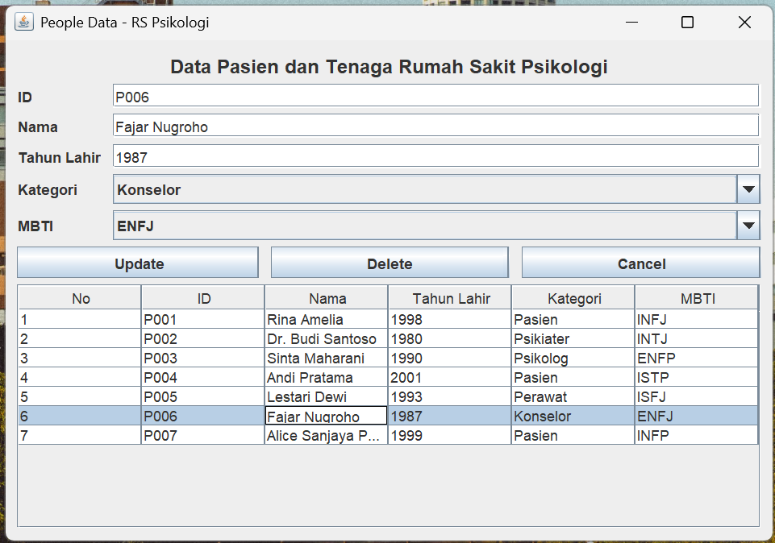

#### Mengubah isi data
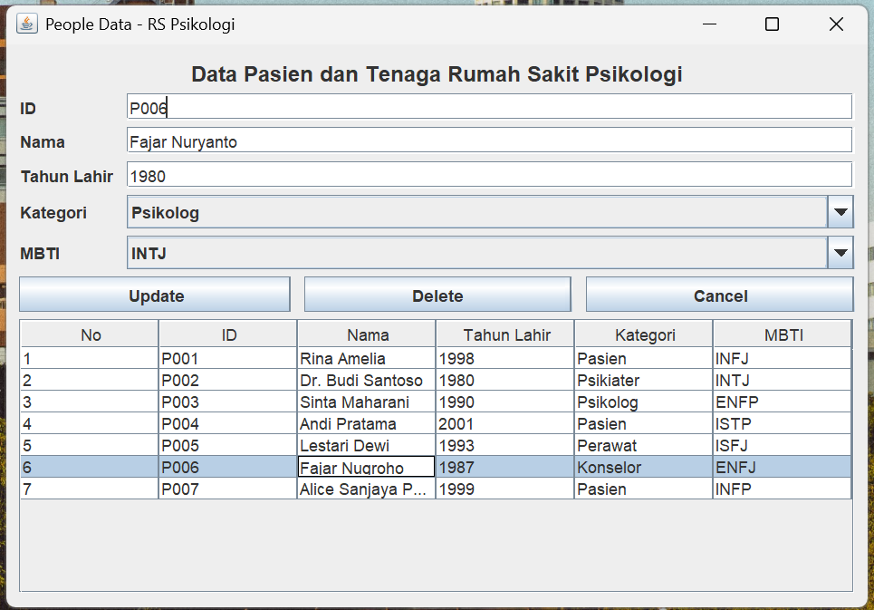

#### Data berhasil diubah
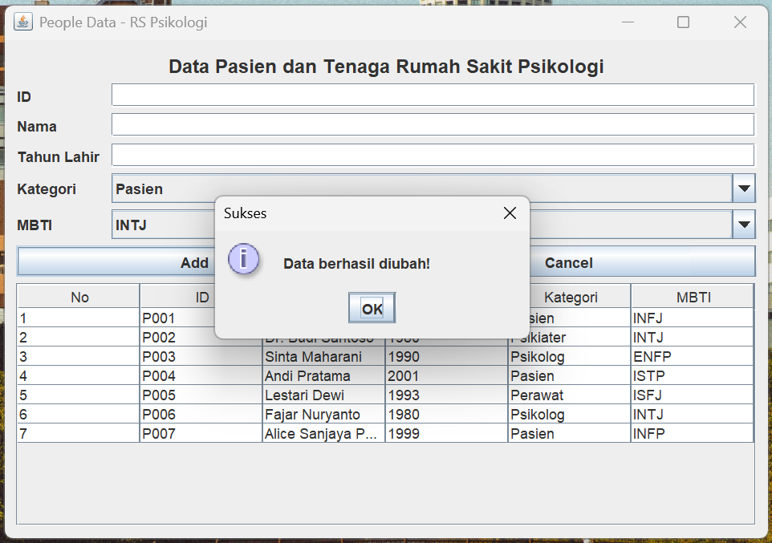

#### Menampilkan data setelah diubah
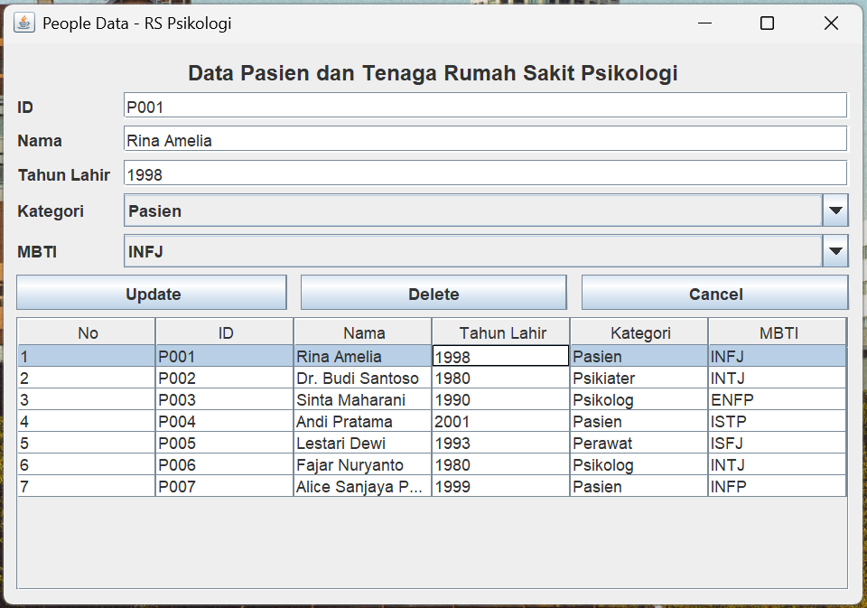

### 4. Delete – menghapus data (dengan konfirmasi)

#### Memilih data


#### Mengonfirmasi penghapusan data
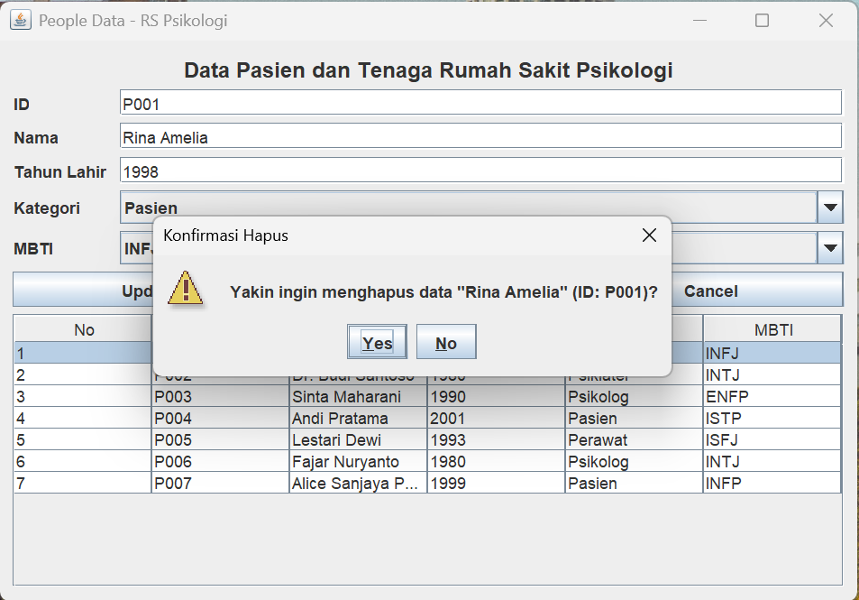

#### Data berhasil dihapus
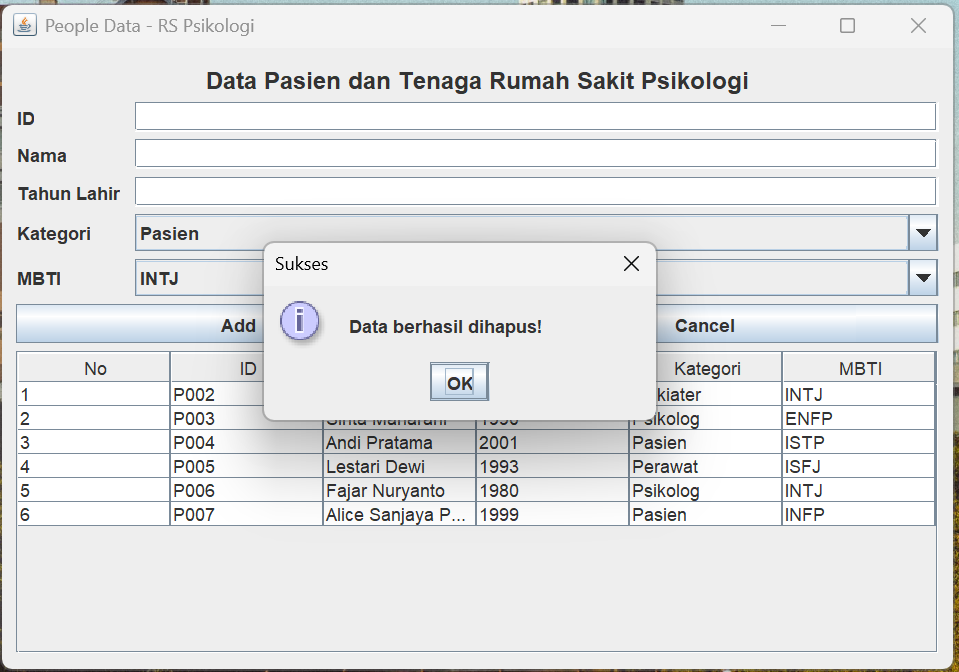

#### Menampilkan data setelah dihapus
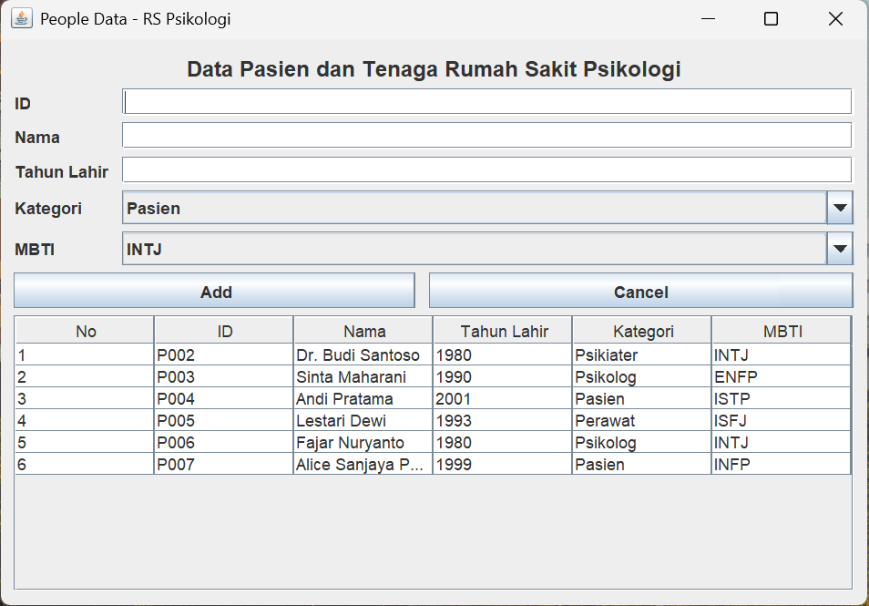

### 5. Validasi input / error handling

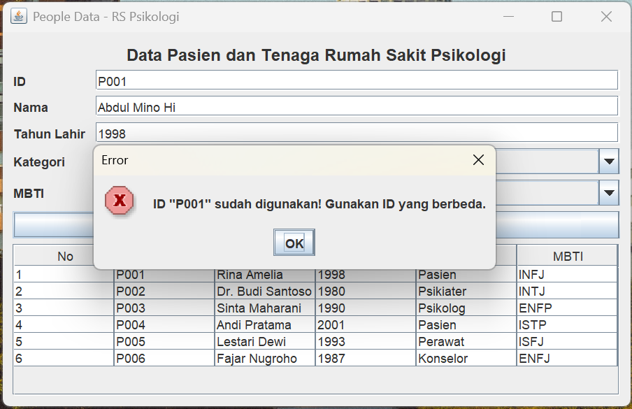

## Catatan

- Data bersifat **sementara** dan hilang saat aplikasi ditutup.
- Ide pengembangan: simpan ke file/database, tambah pencarian dan pengurutan.
